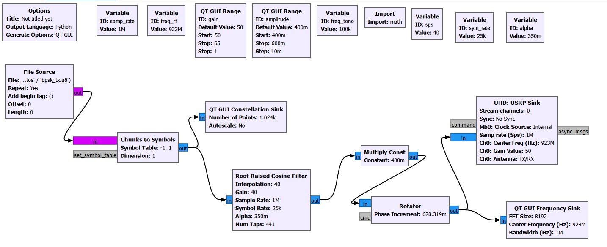
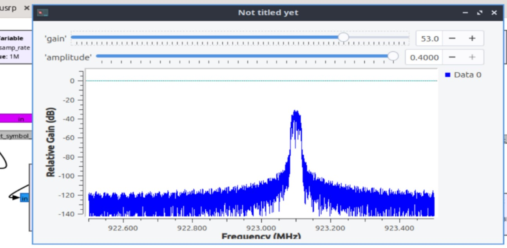
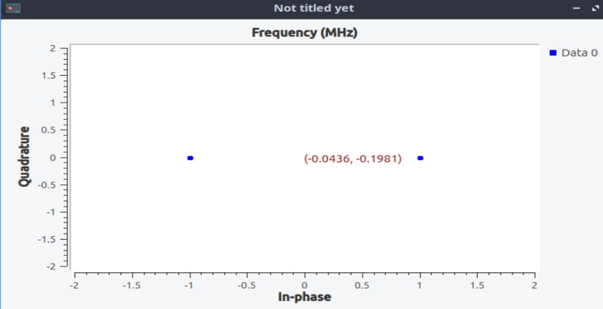
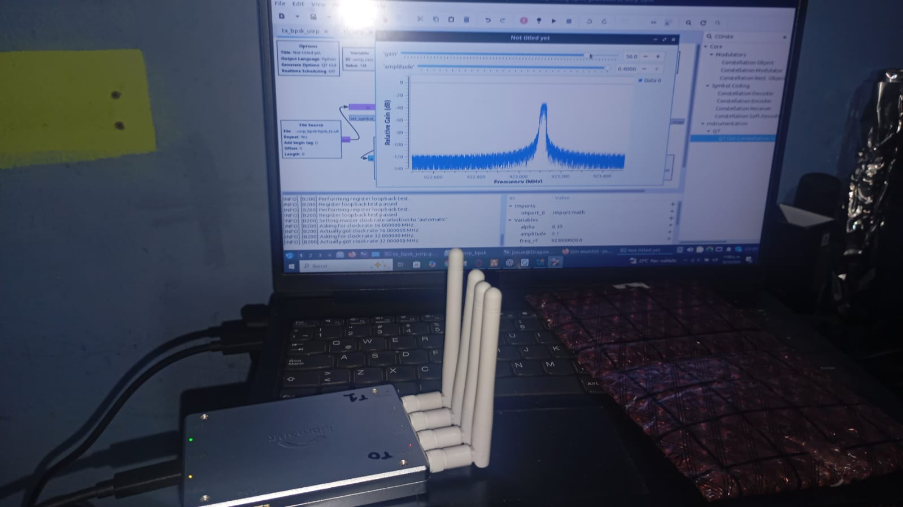
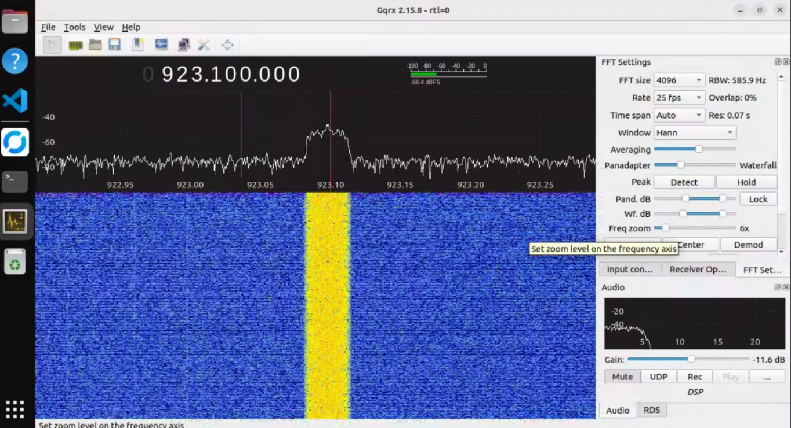
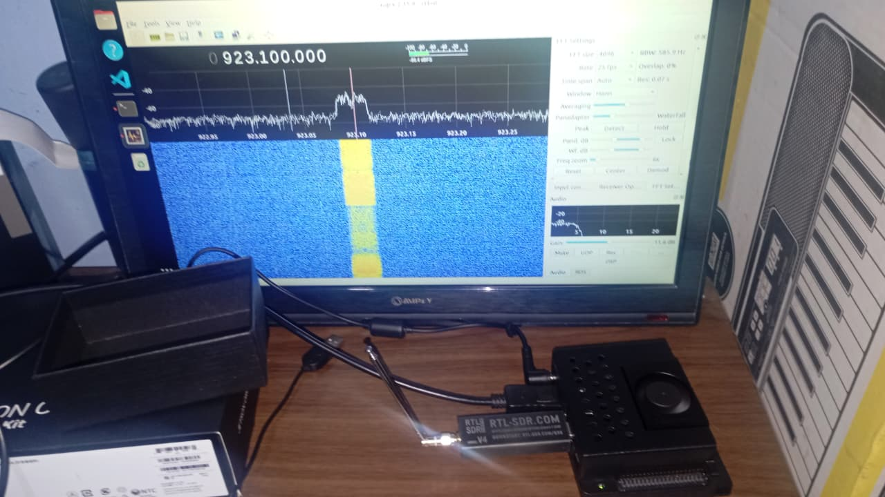

# Explicación teórica: transmisor BPSK

## Resumen del flujo

El diagrama lee bytes de un archivo, los mapea a símbolos BPSK complejos, aplica un filtro interpolador Root Raised Cosine (RRC), escala las muestras, rota la fase para desplazar el espectro en banda base y envía las muestras a un UHD USRP Sink. El bloque QT GUI de constelación observa los símbolos antes del filtro; el Frequency Sink observa la señal desplazada a la salida del rotador antes del sink UHD.

```text
File Source (byte, repetir)
  → Chunks to Symbols: {0,1} → {−1,+1}
      ├→ QT GUI Constellation
      └→ RRC interpolador ×40 → Multiply Const → Rotator +100 kHz
                                             ├→ QT GUI Frequency Sink
                                             └→ UHD USRP Sink
```

## Modelo de señal y tasas

El mapeador asigna cada byte de entrada como una unidad de símbolo, usando el índice 0 o 1 para seleccionar $-1+j0$ o $+1+j0$. Para bytes binarios $b_k\in\{0,1\}$, el símbolo es $a_k=2b_k-1$. No hay un bloque empaquetador o desempaquetador de bits: cada byte selecciona un único símbolo; un byte con otro valor no se convierte automáticamente en ocho bits.

El filtro interpolador produce `sps=40` muestras por símbolo. Con $F_s=1\,\mathrm{MHz}$, la tasa de símbolos es:

$$
R_s=\frac{F_s}{\mathrm{sps}}=\frac{1\,\mathrm{MHz}}{40}=25\,\mathrm{ksímbolos/s}.
$$

En BPSK ideal cada símbolo lleva un bit, por lo que la tasa de datos nominal es 25 kbit/s cuando cada byte de entrada es 0 o 1. El archivo histórico tiene 100 000 bytes binarios; a 25 000 símbolos/s, un recorrido dura nominalmente $100000/25000=4\,\mathrm{s}$. El File Source repite indefinidamente; esa repetición no añade delimitación de trama.

El factor de exceso de ancho de banda del RRC es $\alpha=0.35$. Para pulsos Raised Cosine ideales, el ancho nulo-a-nulo es:

$$
B=(1+\alpha)R_s=1.35\times25\,\mathrm{kHz}=33.75\,\mathrm{kHz}.
$$

Ese espectro está centrado inicialmente en 0 Hz, con media banda a cada lado. El rotador lo traslada a +100 kHz en banda base; el centro nominal pasa a 923.1 MHz al sintonizar el UHD sink a 923 MHz. El ancho teórico sigue siendo 33.75 kHz. La medida real también depende del truncamiento FIR, datos, ventana de análisis, LO y hardware.

Un RRC en transmisión es un filtro de raíz. Si se combina con un filtro RRC coincidente en recepción, las respuestas se multiplican y forman una respuesta Raised Cosine ideal que satisface cero ISI en los instantes de muestreo bajo sincronización adecuada. Este diagrama contiene solo la cadena transmisora.

El rotador multiplica cada muestra por $e^{j\theta[n]}$, con incremento $\Delta\theta=2\pi f_{tono}/F_s$. Para 100 kHz y 1 MHz, $\Delta\theta=0.2\pi$ radianes por muestra. El rotador no codifica datos; desplaza la señal útil desde DC. Esa decisión puede facilitar verla en un receptor cuyo centro presenta fuga del LO o un pico DC; no elimina esos efectos. Un receptor BPSK debe volver a trasladar el canal a banda base con una traslación digital de −100 kHz, implementada aquí mediante el FIR trasladador del receptor y realizar sincronización de frecuencia, temporización y fase.
## Variables del diagrama

| Variable | Valor | Función |
|---|---:|---|
| `samp_rate` | 1 MHz | Frecuencia de muestreo del filtro interpolador, análisis espectral y UHD sink. |
| `sps` | 40 | Muestras por símbolo e interpolación del filtro. |
| `sym_rate` | `samp_rate/sps` = 25 ksym/s | Tasa de símbolos usada en el diseño RRC. |
| `alpha` | 0.35 | Factor de exceso de ancho de banda del RRC. |
| `freq_rf` | 923 MHz | Frecuencia central del UHD sink y centro presentado al analizador espectral. |
| `freq_tono` | 100 kHz | Desplazamiento positivo aplicado por el rotador complejo. El nombre `freq_tono` es heredado; en este diagrama no hay un generador de tono. |
| `amplitude` | 0.4 | Escala compleja aplicada después del RRC; deslizador 0.40–0.60, paso 0.01. |
| `gain` | 50 dB | Ganancia UHD inicial del canal 0; deslizador 50–65 dB, paso 1 dB. Es ganancia configurada, no potencia RF en dBm. |

## Bloques y parámetros efectivos

### File Source (`blocks_file_source_0`)

| Parámetro | Valor |
|---|---|
| Tipo de salida | Byte, vector length 1 |
| Archivo en el GRC/Python | `~/sdr-alertas/datos/bpsk_tx.u8` |
| Generador incluido | `datos_prueba/generar_bits.py`, ejecutado desde la raíz del repositorio |
| Archivo de datos histórico incluido | `archivo_de_envio/bpsk_tx.u8` (100 000 bytes; todos son 0 o 1) |
| Repetir | Sí (`True`) |
| Offset / longitud | 0 / 0 (sin límite de lectura configurado) |
| Begin tag | `PMT_NIL` (sin etiqueta de inicio añadida) |

El generador produce un archivo binario determinista en `~/sdr-alertas/datos/bpsk_tx.u8` por defecto, usando semilla 2026; admite `--salida RUTA` para elegir otra ubicación. La propiedad `File` del File Source debe coincidir con la ruta del archivo generado. El archivo histórico del repositorio contiene únicamente índices 0 y 1; cada byte elige uno de los dos símbolos, no representa texto ni bits empaquetados.
### Chunks to Symbols (`digital_chunks_to_symbols_xx_0`)

| Parámetro | Valor |
|---|---|
| Implementación generada | `digital.chunks_to_symbols_bc` |
| Tabla | `[-1+0j, +1+0j]` |
| `D` | 1 |
| Entrada/salida | byte índice → símbolo complejo |

El byte selecciona un elemento de la tabla. Para la interpretación BPSK binaria descrita, los valores de entrada deben ser 0 o 1. La constelación ideal se encuentra sobre el eje real, en −1 y +1.

### QT GUI Constellation Sink (`qtgui_const_sink_x_0`)

| Parámetro | Valor |
|---|---|
| Entrada | símbolos mapeados, directamente desde Chunks to Symbols |
| Muestras mostradas (`size`) | 1024 |
| Ejes I y Q | −2 a +2 |
| Actualización | 0.10 s |
| Trigger | Libre; una entrada compleja |
| Autoscale / grilla | Desactivados |

Al estar conectado antes del RRC, muestra los puntos de decisión discretos del mapeador, no la trayectoria filtrada ni la constelación recibida por un receptor.

### Root Raised Cosine Filter (`root_raised_cosine_filter_0`)

| Parámetro | Valor |
|---|---|
| Tipo | FIR interpolador complejo a complejo con coeficientes reales (`interp_fir_filter_ccf`) |
| Interpolación / decimación | `sps` / 1 = 40 / 1 |
| Frecuencia de muestreo | 1 MHz |
| Tasa de símbolos | 25 ksym/s |
| Ganancia de diseño | `sps` = 40 |
| Exceso de ancho de banda | `alpha` = 0.35 |
| Número de taps | `11*sps+1` = 441 |


El interpolador opera sobre la secuencia compleja de símbolos y usa una respuesta al impulso de coeficientes reales $h[n]$. Conceptualmente inserta $sps-1$ ceros entre símbolos y filtra:

$$
x[n]=\sum_k a_k h[n-k\,sps].
$$

La respuesta al impulso es RRC, de raíz cuadrada. Si se combina con un filtro RRC coincidente en recepción, el producto de las respuestas en frecuencia es Raised Cosine: banda pasante plana para $|f|\le(1-\alpha)R_s/2$, transición cosenoidal hasta $(1+\alpha)R_s/2$ y cero fuera de banda en el modelo ideal. Una forma temporal ideal, con $T=1/R_s$ y $\tau=t/T$, es:

$$
h(t)=\frac{1}{\sqrt{T}}\frac{\sin\left(\pi(1-\alpha)\tau\right)+4\alpha\tau\cos\left(\pi(1+\alpha)\tau\right)}{\pi\tau\left(1-(4\alpha\tau)^2\right)},
$$

con valores límite por continuidad en los puntos singulares. El diseño GNU Radio calcula una aproximación FIR de longitud finita de esa respuesta. Para $R_s=25$ ksym/s y $\alpha=0.35$, los bordes ideales son $8.125$ kHz y $16.875$ kHz respecto al centro; el ancho nulo-a-nulo es 33.75 kHz. El desplazamiento del rotador mueve esos bordes a alrededor de +100 kHz en banda base.

Los 441 taps tienen retardo de grupo nominal $(441-1)/2=220$ muestras, equivalentes a 220 μs a 1 Msps. `gain=sps=40` es el parámetro de escala de diseño del filtro; compensa aproximadamente la inserción de ceros para conservar una amplitud de escala comparable al flujo de símbolos. No es una normalización de potencia RF ni garantiza una magnitud exacta para cualquier secuencia.

En ejecución, el FIR interpolador implementa la interpolación mediante fases polifásicas: calcula las muestras de salida necesarias sin materializar primero un flujo lleno de ceros. El File Source se repite en continuo; al volver al principio entrega nuevos símbolos al filtro sin reiniciar sus estados. Puede aparecer una transición entre el final y el comienzo del archivo si los símbolos no conectan suavemente, pero no hay un reinicio del estado del filtro en cada repetición. Al inicio del proceso sí existen condiciones iniciales/transitorio.

GNU Radio define `alpha` como el factor de exceso de ancho de banda y requiere que la tasa de símbolos sea un factor de la frecuencia de muestreo para la función de diseño RRC.

### Multiply Const (`blocks_multiply_const_vxx_0`)

| Parámetro | Valor |
|---|---|
| Tipo de muestra | Complex |
| Longitud vectorial | 1 |
| Constante | `amplitude` = 0.4 inicial |

Multiplica las componentes complejas interpoladas por una constante real, escalando amplitud. No equivale a fijar una potencia calibrada en RF.

### Rotator (`blocks_rotator_cc_0`)

| Parámetro | Valor |
|---|---|
| Incremento de fase | `2*pi*freq_tono/samp_rate` |
| Incremento inicial | $0.2\pi$ rad/muestra |
| Offset inicial | +100 kHz complejo |
| Conexiones de salida | Frequency Sink y UHD USRP Sink |

Se usa como mezclador digital complejo para desplazar la señal conformada desde 0 Hz hacia +100 kHz. Este offset pone el canal útil lejos de DC y puede facilitar la inspección en receptores que presentan fuga del oscilador local o un pico de offset en el centro; el rotador no elimina esos errores. Para demodularla, el receptor debe aplicar el desplazamiento inverso de −100 kHz y sincronizar frecuencia, temporización y fase. Al cambiar `freq_tono`, el script recalcula el incremento de fase.

### QT GUI Frequency Sink (`qtgui_freq_sink_x_0`)

| Parámetro | Valor |
|---|---|
| Entrada | 1 flujo complejo, desde Rotator |
| FFT | 8192 puntos |
| Ventana | Blackman–Harris |
| Centro / ancho | `freq_rf` = 923 MHz / `samp_rate` = 1 MHz |
| Actualización / promedio | 0.10 s / 1.0 |
| Eje vertical | Relative Gain, dB, −140 a +10 |
| Modo | frecuencia completa, disparo libre, sin autoscale ni grilla |

Esta gráfica muestra la señal digital rotada. El `fc` y el ancho de banda etiquetan el eje; no convierten la gráfica en una medición RF calibrada.

### UHD USRP Sink (`uhd_usrp_sink_0`)

| Parámetro | Valor |
|---|---|
| Formato de muestras | `fc32` |
| Número de canales | 1; `stream_chans=[0]`, Python `channels=[0]` |
| Frecuencia central canal 0 | `freq_rf` = 923 MHz |
| Tasa de muestreo | 1 MHz |
| Antena canal 0 | `TX/RX` |
| Ganancia canal 0 | `gain` = 50 dB inicial |
| Reloj | `internal` |
| Direcciones y argumentos UHD | vacíos/por defecto |
| Sincronización | `none` |

Aunque GRC serializa varios campos por canal, el sink declara un canal y selecciona índice lógico 0. El índice de streaming identifica el canal lógico de transmisión.

## Dependencias y ejecución

El Python fue generado con GNU Radio 3.10.12.0 y utiliza los módulos `blocks`, `digital`, `filter`, `qtgui`, `uhd`, PyQt5 y PMT. Se necesita una instalación UHD compatible con la USRP. Desde la raíz del repositorio, genere datos y abra el flujo con:

```sh
python3 datos_prueba/generar_bits.py
gnuradio-companion MINIB220_laptop_files/implementacion_bpsk_tx/tx_bpsk_usrp_base.grc
```

El generador y el archivo destino indicado por File Source deben coincidir. Después de abrir y ejecutar desde GRC, o regenerar el Python, desde la raíz del repositorio:

```sh
python3 MINIB220_laptop_files/implementacion_bpsk_tx/tx_bpsk_usrp.py
```

## Consideraciones de interpretación

- 923 MHz se conserva como frecuencia configurada del proyecto; no se afirma que sea libre de licencia o adecuada para cualquier jurisdicción.
- `gain` es la ganancia que se solicita a UHD, expresada en dB, no la potencia radiada ni una lectura en dBm. No se puede inferir potencia de salida de este parámetro aislado.
- `amplitude` es escala de muestras complejas, no una calibración de potencia.
- Las gráficas QT GUI muestran señales internas del flujo GNU Radio. Para evaluar RF se requiere instrumentación y condiciones de medición apropiadas.

## Capturas













Las capturas muestran las señales internas del transmisor y su observación en el extremo receptor.

## Referencias técnicas

- GNU Radio, [API `firdes::root_raised_cosine`](https://www.gnuradio.org/doc/doxygen/classgr_1_1filter_1_1firdes.html) (parámetros de muestreo, tasa de símbolos, `alpha` y cantidad de taps).
- GNU Radio, [documentación de bloques de filtrado](https://www.gnuradio.org/doc/doxygen/page_filter.html) (RRC como filtro de conformación de pulsos).
- Ettus Research, [configuración de dispositivos UHD y mapeo de canales de streaming](https://files.ettus.com/manual/page_configuration.html).


