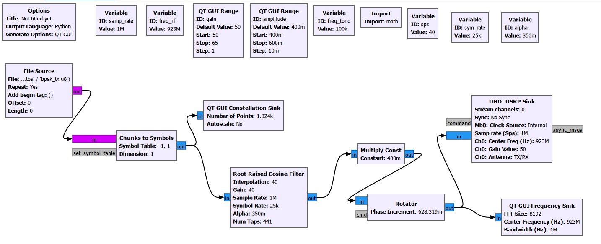
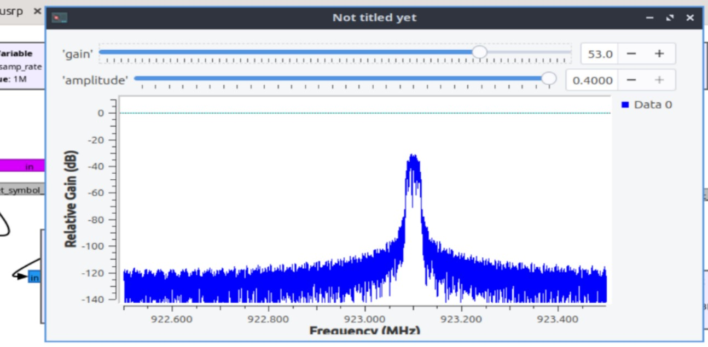
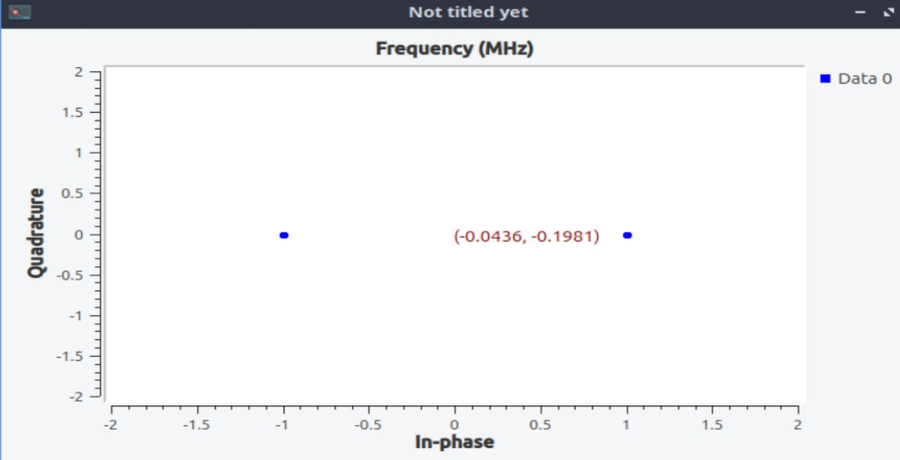
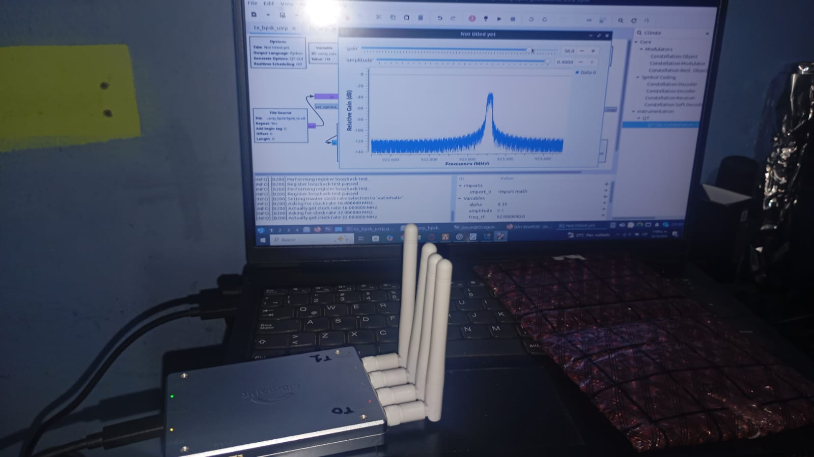
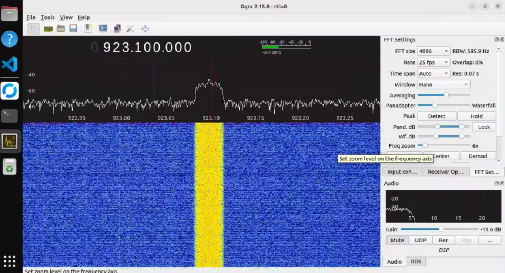
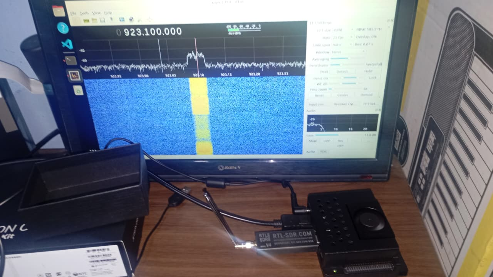

# Transmisor BPSK con Mini B220 (UHD: B210)

Diagrama GNU Radio Companion y script Python para formar una secuencia BPSK desde un archivo de bytes, aplicar conformación RRC y transmitirla con UHD.

- Flujo: [`tx_bpsk_usrp_base.grc`](tx_bpsk_usrp_base.grc)
- Python generado: [`tx_bpsk_usrp.py`](tx_bpsk_usrp.py)
- Secuencia de bytes de referencia: [`archivo_de_envio/bpsk_tx.u8`](archivo_de_envio/bpsk_tx.u8)
- Teoría, parámetros y dependencias: [EXPLICACION_TEORICA/README.md](EXPLICACION_TEORICA/README.md)
- Capturas: [flujo](../../imagenes/bpsk_tx_flujo.png), [espectro](../../imagenes/bpsk_tx_espectro.png), [constelación](../../imagenes/bpsk_tx_constelacion.png), [montaje TX](../../imagenes/bpsk_tx_montaje.png), [recepción Gqrx](../../imagenes/bpsk_rx_gqrx.png), [montaje RX](../../imagenes/bpsk_rx_montaje.png)

## Reproducción

Con GNU Radio 3.10, PyQt5, UHD y una USRP compatible, desde la raíz del repositorio genere los datos de entrada y abra el diagrama:

```sh
python3 datos_prueba/generar_bits.py
gnuradio-companion MINIB220_laptop_files/implementacion_bpsk_tx/tx_bpsk_usrp_base.grc
```

El generador crea `~/sdr-alertas/datos/bpsk_tx.u8` de forma determinista por defecto; `--salida RUTA` permite elegir otra ubicación. La propiedad `File` del bloque File Source debe coincidir con el archivo generado. El flujo puede ejecutarse desde GRC o mediante el programa Python:

```sh
python3 MINIB220_laptop_files/implementacion_bpsk_tx/tx_bpsk_usrp.py
```

El File Source repite el archivo indefinidamente. El diagrama no añade cabecera, sincronización de trama ni texto `HOLA`.

La salida UHD está configurada para muestras complejas `fc32`, tasa 1 Msps, frecuencia central 923 MHz, antena `TX/RX`, ganancia inicial 50 dB y `stream_chans=[0]`/`channels=[0]`. El índice identifica el canal lógico seleccionado en UHD. El uso de la frecuencia está sujeto a las condiciones aplicables a cada montaje. Ganancia UHD en dB no equivale a potencia de salida en dBm.

## Evidencia visual

### Cadena transmisora BPSK



Los bits se mapean a dos símbolos, se conforman con RRC, se escalan y se trasladan digitalmente antes de UHD.

### Espectro del transmisor BPSK



La banda útil se sitúa alrededor de 923,1 MHz en el eje etiquetado del monitor. Su ancho ideal total es 33,75 kHz.

### Constelación del mapeador TX



El monitor toma la señal antes del filtro: los puntos son −1 y +1, con Q igual a cero. No representa los transitorios del pulso ni el canal RF.

### Montaje del transmisor durante la prueba



La fotografía relaciona la laptop, la Mini B220 y la interfaz del flujo que genera la señal.

### BPSK observada en Gqrx de la Jetson



El receptor muestra energía RF con la ubicación espectral prevista. Observar el espectro no demuestra todavía recuperación de bits.

### Montaje receptor con Jetson y RTL-SDR V4



La fotografía identifica el extremo de recepción independiente y su pantalla de observación RF.

