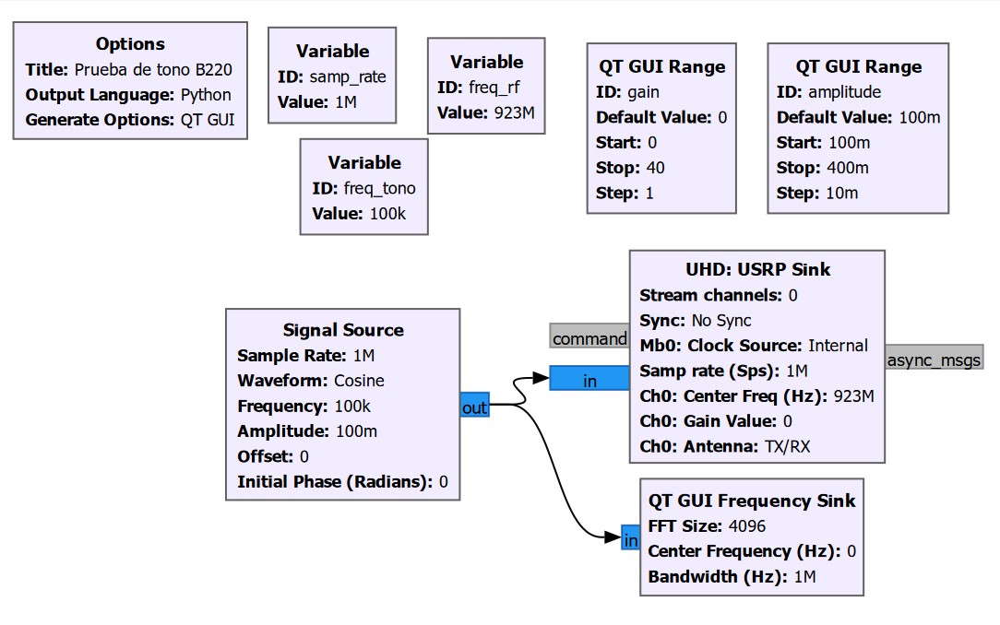
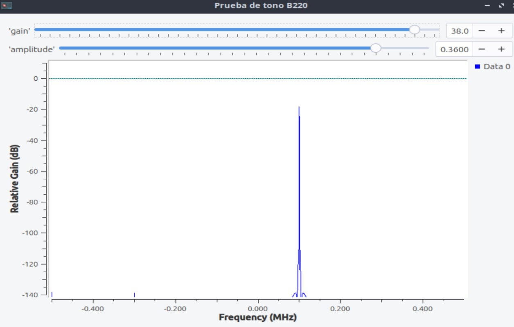
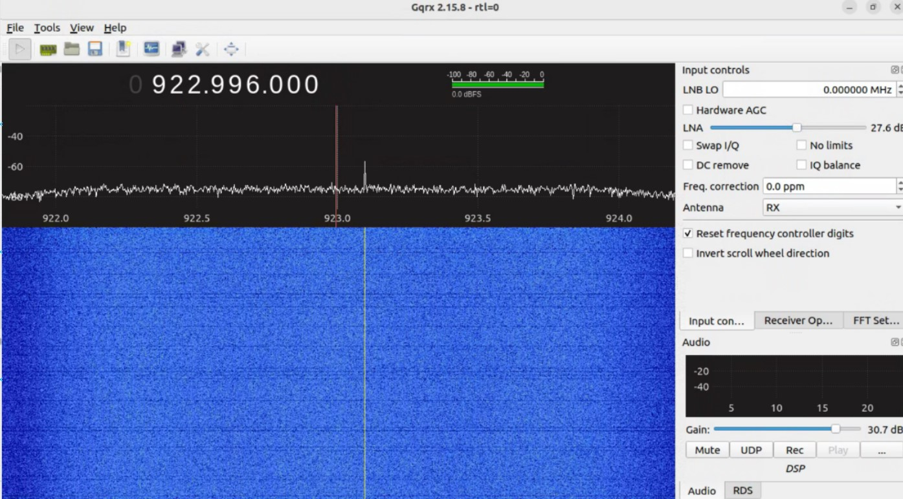

# Explicación teórica: prueba de tono B220

## Objetivo y recorrido

Este diagrama sirve como prueba de transmisión continua de una portadora desplazada desde el centro de sintonía. No genera una ráfaga ni un pulso rectangular. `analog_sig_source_x_0` genera muestras complejas y bifurca la señal: una rama llega al analizador QT GUI y otra al bloque `UHD: USRP Sink`.

```text
Signal Source (complex cosine) ─┬─> QT GUI Frequency Sink
                                 └─> UHD USRP Sink, canal lógico 0
```

Con la configuración nominal, la señal compleja de banda base es aproximadamente:

$x[n]=0.1e^{j2\pi(100000)n/10^6}$

El sink sintoniza el LO a 923 MHz, por lo que el tono positivo de +100 kHz se ubica nominalmente en 923.1 MHz. La fórmula describe el mapeo ideal de banda base a RF; la frecuencia radiada efectiva depende del LO real y la configuración del equipo. El QT GUI está conectado antes del sink y muestra banda base centrada en 0 Hz, no una medición RF del transmisor.

## Parámetros y bloques

### Variables

| Variable | Valor inicial | Control/rango | Uso |
|---|---:|---:|---|
| `samp_rate` | 1 MHz | fija | Frecuencia de muestreo de fuente, QT GUI y sink UHD. |
| `freq_rf` | 923 MHz | fija | Frecuencia central configurada en el canal 0 del UHD sink. |
| `freq_tono` | 100 kHz | fija | Frecuencia del tono complejo en banda base. |
| `amplitude` | 0.1 | deslizador 0.10–0.40, paso 0.01 | Amplitud de muestras de Signal Source. Es escala digital; no especifica potencia radiada. |
| `gain` | 0 | deslizador 0–40, paso 1 | Ganancia UHD del canal. Es un ajuste expresado en dB, no una lectura de potencia de salida en dBm. |

### Signal Source (`analog_sig_source_x_0`)

| Parámetro | Valor |
|---|---|
| Tipo de salida | Complex (`analog.sig_source_c`) |
| Forma | Coseno (`GR_COS_WAVE`) |
| Frecuencia | `freq_tono` = 100 kHz |
| Frecuencia de muestreo | `samp_rate` = 1 MHz |
| Amplitud | `amplitude` = 0.1 inicial |
| Offset | 0 |
| Fase | 0 rad |

Para una salida compleja, la forma de onda representa esencialmente una rotación de fase $e^{j2\pi f n/F_s}$. No debe interpretarse como un pulso real de 100 kHz. Su espectro ideal tiene una sola componente compleja en +100 kHz; el desplazamiento del centro del transmisor suma esa frecuencia a la sintonía RF.

### QT GUI Frequency Sink (`qtgui_freq_sink_x_0`)

| Parámetro | Valor |
|---|---|
| Entrada | 1, compleja, conectada directamente a Signal Source |
| FFT | 4096 puntos |
| Ventana | Blackman–Harris |
| Centro/rango | centro 0 Hz, ancho `samp_rate` (1 MHz) |
| Actualización | 0.10 s |
| Promedio FFT | 1.0 |
| Escala vertical | −140 a +10, etiqueta `Relative Gain`, unidades dB |
| Disparo | Libre; autoscale y grilla desactivados |

La gráfica presenta magnitud espectral relativa del flujo digital. No calibra potencia en el conector RF ni sustituye una medición con equipo calibrado.

### UHD USRP Sink (`uhd_usrp_sink_0`)

| Parámetro | Valor |
|---|---|
| Formato CPU | `fc32` (muestras complejas de 32 bits por componente) |
| Canales | 1; `stream_chans=[0]` y Python `channels=[0]` |
| Frecuencia central, canal 0 | `freq_rf` = 923 MHz |
| Tasa de muestreo | `samp_rate` = 1 MHz |
| Antena, canal 0 | `TX/RX` |
| Ganancia, canal 0 | `gain` = 0 dB inicial, deslizador 0–40 dB |
| Reloj | fuente interna |
| Dirección/parámetros de dispositivo | vacíos/por defecto |
| Sincronización | `none`; sin sincronización externa impuesta |

El diagrama reserva parámetros para varios canales en el archivo GRC, pero configura una sola salida (`nchan=1`) y asigna el flujo al índice lógico 0. Esa selección coincide con el Python generado y se conserva tal como figura en los archivos; por sí sola no demuestra una limitación del canal.

## Dependencias y ejecución

El GRC fue guardado con GNU Radio 3.10.12.0. La generación Python requiere GNU Radio con sus módulos `analog`, `qtgui`, `uhd`, PyQt5 y el backend UHD correspondiente. La detección y compatibilidad de hardware debe verificarse en el equipo objetivo; este repositorio no aporta una ejecución local validada en hardware.

Desde este directorio, abra `tx_usrp.grc` con:

```sh
gnuradio-companion tx_usrp.grc
```

Después de abrir el diagrama, ejecútelo desde GRC. Si el Python se genera con una instalación compatible, puede lanzarse con:

```sh
python3 tx_usrp.py
```

## Consideraciones de interpretación

- 923 MHz es el valor fijado en el flujo, no una afirmación de que la banda esté libre. Antes de transmitir, verifique normativa, autorización y límites aplicables en el lugar de operación.
- El valor `gain` de UHD en dB no es potencia de salida en dBm. La potencia depende del hardware, frecuencia, calibración, ajustes y condiciones de salida; no se deduce del deslizador.
- `amplitude` ajusta muestras de banda base, no una potencia RF directamente calibrada.
- La captura del analizador QT GUI representa la señal digital en banda base antes del UHD sink.

## Capturas del proyecto







Las imágenes se enlazan como evidencia visual del proyecto; no implican una verificación reproducible en cualquier computador o equipo.

## Referencias técnicas

- GNU Radio, documentación de `gr::analog::sig_source_c`: [namespace `gr::analog`](https://www.gnuradio.org/doc/doxygen/namespacegr_1_1analog.html).
- GNU Radio, documentación de `gr::filter::firdes`: [API de diseño FIR](https://www.gnuradio.org/doc/doxygen/classgr_1_1filter_1_1firdes.html).
- Ettus Research, documentación de configuración UHD y mapeo de canales de flujo: [Configuring Devices and Streamers](https://files.ettus.com/manual/page_configuration.html).


