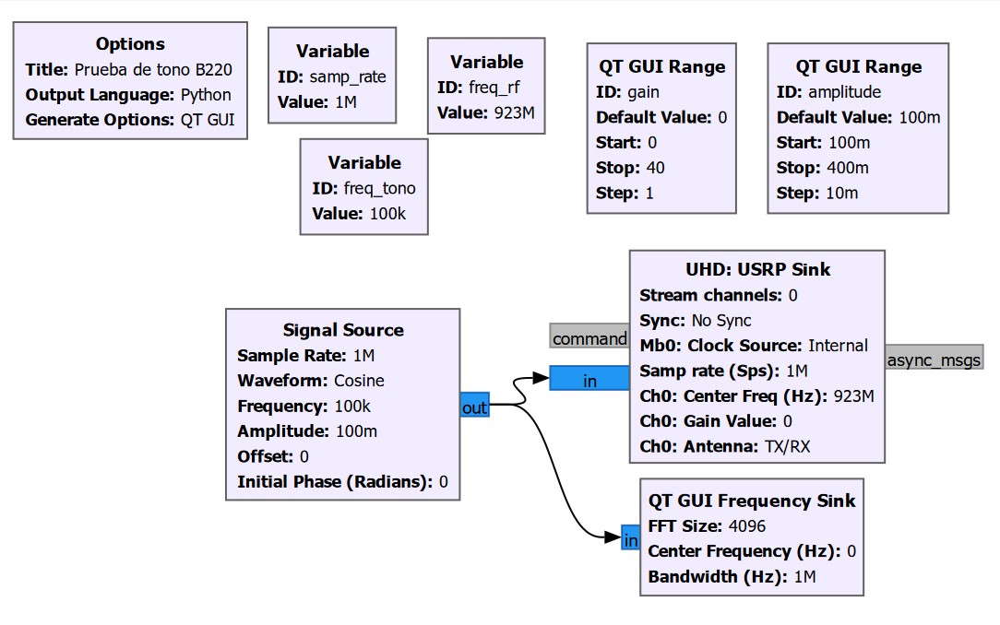
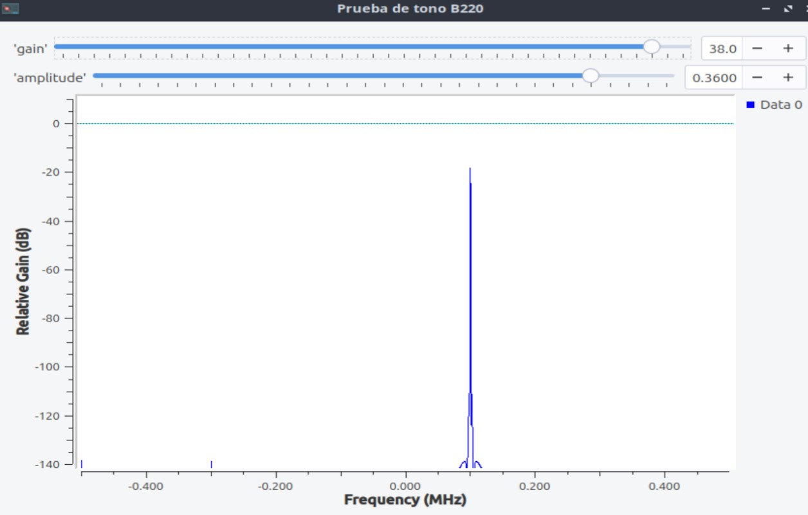
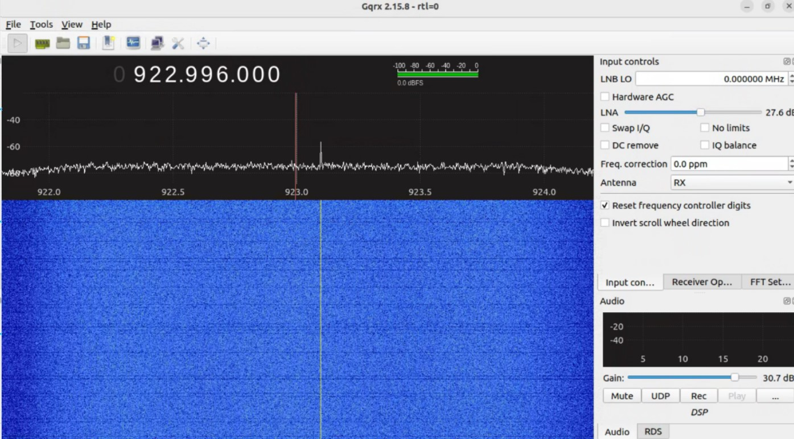

# Prueba de tono con Mini B220 (UHD: B210)

Diagrama GNU Radio Companion y script Python generado para transmitir un tono complejo con una Mini B220 (UHD: B210) y observar su espectro de banda base en QT GUI.

- Flujo: [`tx_usrp.grc`](tx_usrp.grc)
- Python generado por GNU Radio 3.10.12.0: [`tx_usrp.py`](tx_usrp.py)
- Explicación de bloques, parámetros y teoría: [EXPLICACION_TEORICA/README.md](EXPLICACION_TEORICA/README.md)
- Capturas: [flujo](../../imagenes/tono_flujo.png), [QT GUI](../../imagenes/tono_qt_gui.png), [recepción en Gqrx/Jetson](../../imagenes/tono_gqrx_jetson.png)

## Reproducción

Con GNU Radio 3.10, PyQt5, UHD y una USRP compatible instalados, desde este directorio:

```sh
gnuradio-companion tx_usrp.grc
```

La ejecución desde GRC requiere seleccionar el dispositivo y el canal de transmisión. El programa generado también se ejecuta con `python3 tx_usrp.py`.

El flujo usa `stream_chans=[0]`/`channels=[0]`, una sola salida compleja y antena `TX/RX`. El índice corresponde al canal lógico seleccionado en UHD.

La frecuencia RF está configurada en 923 MHz con un tono de +100 kHz en banda base, por lo que la componente se espera nominalmente en 923.1 MHz. La idoneidad legal de transmitir en esa frecuencia depende de la jurisdicción, autorización y condiciones locales; no se presupone que sea una frecuencia libre. El control `gain` es ganancia UHD en dB, no potencia de salida en dBm.

## Evidencia visual

### Flujo de generación del tono complejo



El generador de 100 kHz alimenta el monitor y el sumidero UHD. La frecuencia RF esperada es la suma del centro UHD y el desplazamiento digital.

### Tono digital observado en Qt GUI



El pico confirma la generación digital. La escala no mide potencia RF calibrada.

### Tono recibido en Gqrx sobre la Jetson



La aparición y desaparición del pico al iniciar y detener TX permiten asociarlo con el transmisor del montaje.

