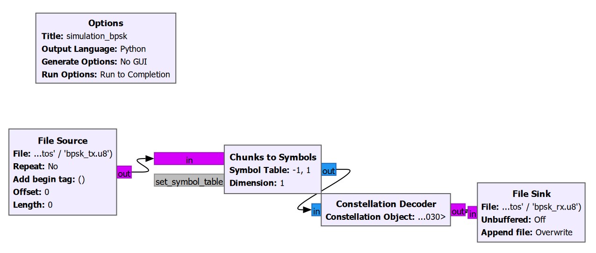
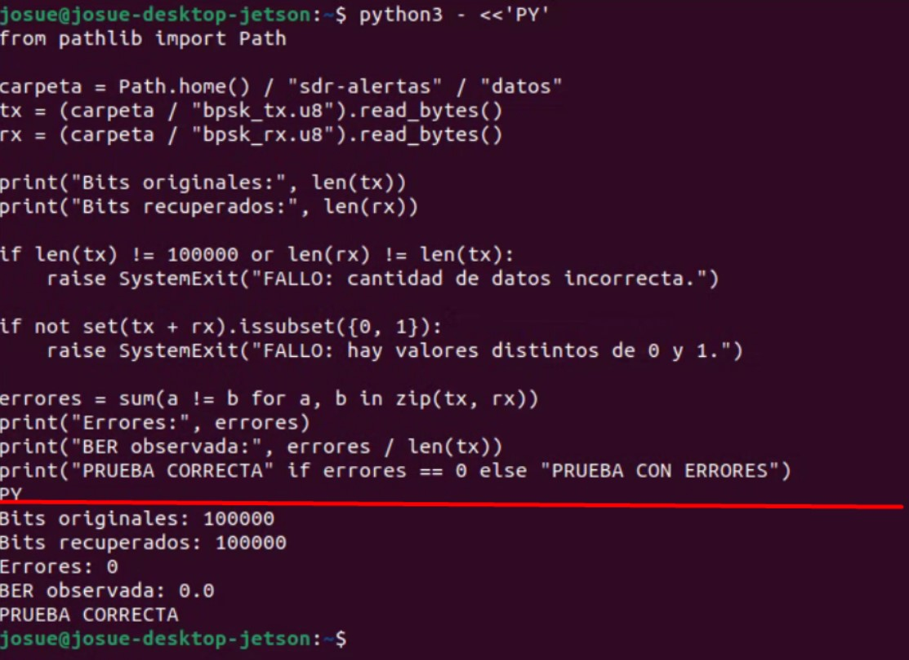

# Simulación BPSK de transmisión y recepción

Este ejemplo usa GNU Radio para leer bytes binarios, mapearlos a símbolos BPSK, decodificarlos y guardar los bytes recuperados. El GRC y el script generado comparten el mismo grafo; no hay canal de ruido, modulador pasabanda, SDR ni enlace RF en este flujo. Es una prueba de mapeo y decisión ideal.

## Preparar los datos y ejecutar

Desde la raíz del repositorio, genere el archivo de entrada determinista que consume el flujo:

```bash
python3 datos_prueba/generar_bits.py
```

El generador guarda 100 000 bytes binarios en `~/sdr-alertas/datos/bpsk_tx.u8` (también acepta `--salida RUTA`). En GNU Radio Companion abra `bpsk_simulation.grc` y ejecute; o desde este directorio lance:

```bash
python3 tx_usrp.py
```

GNU Radio escribe `~/sdr-alertas/datos/bpsk_rx.u8`. La ruta del flujo coincide con la del generador. Se requiere GNU Radio 3.10; este GRC fue guardado con GNU Radio 3.10.12.0. Si se usa la versión Python, sus dependencias deben estar instaladas en el mismo entorno.

Comprobación de los archivos:

```bash
python3 comprobacion_ber.py
```

Por omisión, el comprobador usa los archivos de referencia guardados en `archivos_de_simulacion/`. Para comprobar la ejecución recién realizada, indique las rutas de `~/sdr-alertas/datos` explícitamente:

```bash
python3 comprobacion_ber.py --tx ~/sdr-alertas/datos/bpsk_tx.u8 --rx ~/sdr-alertas/datos/bpsk_rx.u8
```

El script valida que haya 100 000 valores en cada archivo, que ambos tengan igual longitud y que cada byte sea 0 o 1; informa el número de errores y la BER. Cualquier error de bit provoca estado de salida distinto de cero.

## Bloques y parámetros

- `blocks.file_source`: lee bytes, sin repetición, desde `bpsk_tx.u8`.
- `digital.chunks_to_symbols_bc`: tabla `[-1+0j, +1+0j]`; la entrada byte 0 mapea a −1 y 1 a +1.
- `digital.constellation_decoder_cb`: decisión más cercana para la constelación BPSK predeterminada; su salida es un byte por símbolo.
- `blocks.file_sink`: guarda los bytes como `bpsk_rx.u8`, sin añadir datos previos.

En el flujo actual no se configuran tasa de símbolos ni tasa de muestreo: se procesa un elemento por byte de entrada y la velocidad efectiva depende del planificador y del almacenamiento. Los archivos `.u8` contienen bytes cuyos valores representan bits 0/1, no un formato comprimido. Los archivos de referencia archivados son una pareja de 100 000 bytes; la comprobación BER reporta su resultado real y no presupone BER cero.

## Diagramas

- [Diagrama del flujo BPSK](../../imagenes/simulacion_bpsk_flujo.png)
- [Gráfica de BER](../../imagenes/simulacion_bpsk_ber.png)
- [Explicación teórica de cada bloque](EXPLICACION_TEORICA/README.md)

## Referencias primarias

- [GNU Radio 3.10.12.0: bloque chunks-to-symbols](https://github.com/gnuradio/gnuradio/tree/v3.10.12.0/gr-digital)
- [GNU Radio 3.10.12.0: decodificador de constelación](https://github.com/gnuradio/gnuradio/tree/v3.10.12.0/gr-digital)
- [GNU Radio 3.10.12.0: fuente y sumidero de archivos](https://github.com/gnuradio/gnuradio/tree/v3.10.12.0/gr-blocks)

## Evidencia visual



La conexión directa entre mapeador y decoder conserva el orden de los símbolos y no introduce ruido ni desajustes de reloj.



La salida de terminal debe identificar los 100 000 bits comparados y el número de diferencias. Es una comprobación de todos los elementos del archivo, no una inferencia a partir de la constelación.
