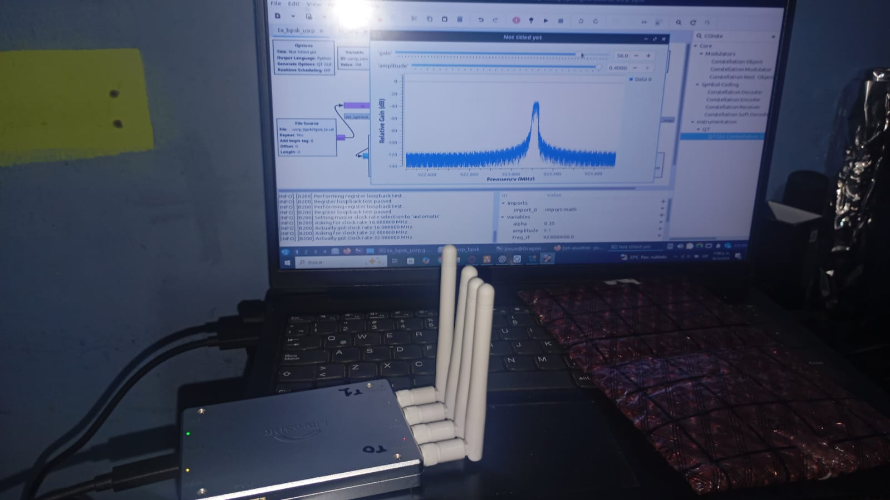
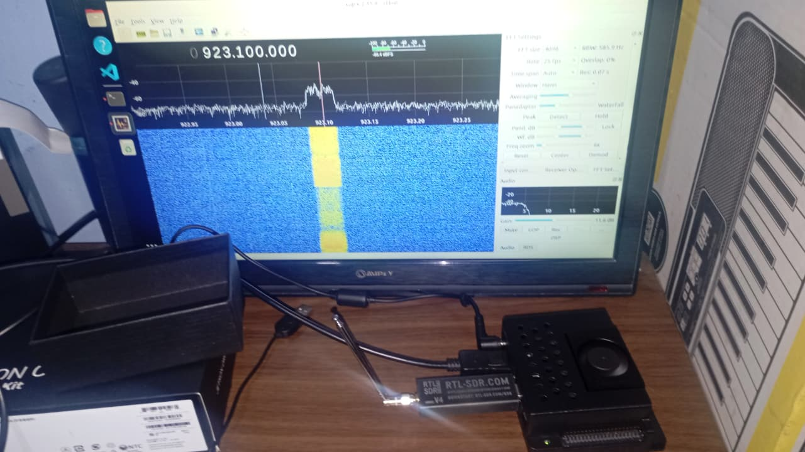

# Enlace BPSK con Mini B220 y RTL-SDR V4 sobre Jetson Orin Nano

Implementación y estudio de un enlace de radio digital BPSK entre dos plataformas independientes. Una laptop con DragonOS y una Mini B220 genera y transmite la señal; una NVIDIA Jetson Orin Nano con RTL-SDR Blog V4 la recibe, sincroniza y convierte nuevamente en bits mediante GNU Radio.

El recorrido comienza con la recepción de FM para verificar el receptor, continúa con una simulación ideal y una prueba de tono, y culmina con transmisión BPSK por radio, visualización de las etapas de recuperación y comparación de los bits recibidos con una referencia conocida.

## Laboratorio y objetivo

| Extremo | Plataforma | Dispositivo RF | Función |
|---|---|---|---|
| TX | Laptop, DragonOS Resolute R1 | Mini B220 LibreSDR, identificada por UHD como B210 | Conformación de pulsos y transmisión BPSK |
| RX | NVIDIA Jetson Orin Nano Developer Kit Super, Ubuntu 22.04.5 LTS, ARM64 | RTL-SDR Blog V4 | Adquisición IQ, sincronización y decisiones binarias |





La configuración conservada usa un centro RF de **923 MHz** y un desplazamiento digital de **+100 kHz**; por tanto, la señal se centra nominalmente en **923,1 MHz**. Esta frecuencia está dentro de las capacidades de ambos SDR y se utilizó con una antena del transmisor destinada a la zona de 915 MHz. El desplazamiento separa la señal útil del centro de conversión, donde pueden aparecer componentes de continua o fuga del oscilador. Es una elección experimental del montaje: no establece que la frecuencia esté desocupada ni constituye una autorización de uso en una jurisdicción determinada.

Con BPSK a **25 kbit/s**, 40 muestras/símbolo en TX y filtros RRC de exceso de banda 0,35, el ancho de banda ideal total es **33,75 kHz**. El receptor reduce 2 MS/s a 100 kS/s y recupera una decisión por símbolo. Las ganancias de los flujos son ajustes de los dispositivos en dB; no son una medición de potencia radiada.

## Recorrido experimental

Cada etapa tiene un README breve, los archivos ejecutables y una carpeta `EXPLICACION_TEORICA` con el desarrollo matemático y de software.

| Orden | Experimento | Contenido |
|---:|---|---|
| 1 | [Presentación del laboratorio](#laboratorio-y-objetivo) | Objetivo, equipos y configuración del enlace |
| 2 | [Receptor FM en Jetson](RTL_SDR_JETSON_files/fm_rx/README.md) | RTL-SDR, remuestreo, demodulación WFM y audio |
| 3 | [Generación de la referencia](datos_prueba/README.md) | 100 000 bits reproducibles; un bit lógico por byte |
| 4 | [Simulación BPSK ideal](MINIB220_laptop_files/simulacion_bpsk_tx_rx/README.md) | Mapeo, decisión y comprobación de BER |
| 5 | [Prueba de tono RF](MINIB220_laptop_files/prueba_pulso_tx/README.md) | Coseno complejo y observación en Gqrx |
| 6 | [Transmisión BPSK](MINIB220_laptop_files/implementacion_bpsk_tx/README.md) | Lectura de bits, RRC, escala, rotación y UHD |
| 7 | [Recepción BPSK y verificación](RTL_SDR_JETSON_files/implementacion_bpsk_rx/README.md) | Filtrado, AGC, Costas, temporización y BER |

## Resultados y alcance

La simulación incluida conserva **100 000 bits TX y 100 000 bits RX idénticos**, con BER observada cero. La implementación RF permitió observar la señal transmitida y recuperar la secuencia binaria con los dos equipos independientes.

Se distinguen dos registros de evaluación RF:

| Registro | Bits comparados | Errores | BER observada | Estado de la evidencia |
|---|---:|---:|---:|---|
| Medición RF documentada durante el desarrollo | 1 176 385 | 0 | 0 | Su captura de 1 250 113 bits no está incluida en esta copia |
| Auditoría de la captura incluida, desde el anclaje validado hasta el final | 769 402 | 145 590 | 0,1892248785 | Reproducible con los archivos de este repositorio |

La segunda captura contiene una región de coincidencia y también una región posterior que deja de coincidir. Los bits almacenados por sí solos no permiten atribuir esa diferencia a apagado del transmisor, pérdida de sincronización u otra causa. La comparación abarca el tramo completo definido por el anclaje; los dos registros corresponden a capturas diferentes.

El límite aproximado de BER al 95 % de la medición histórica sin errores es $3/N \simeq 2,55\times10^{-6}$, bajo las hipótesis indicadas en la [metodología BER](RTL_SDR_JETSON_files/implementacion_bpsk_rx/EXPLICACION_TEORICA/VERIFICACION_BER.md). Una BER observada de cero no garantiza ausencia de errores en toda transmisión futura ni demuestra entrega de paquetes desde el arranque.

## Reproducción

Los [requisitos y procedimientos de ejecución](documentacion/ENTORNO_Y_EJECUCION.md) describen la configuración de la laptop, la Jetson y el entorno de análisis.

Para verificar los archivos ya incluidos, desde la raíz del repositorio:

```bash
python3 MINIB220_laptop_files/simulacion_bpsk_tx_rx/comprobacion_ber.py
python3 RTL_SDR_JETSON_files/implementacion_bpsk_rx/verificacion_ber_rf.py
```

El generador usa la biblioteca estándar de Python. El análisis RF requiere NumPy y SciPy. Los flujos requieren GNU Radio y los controladores de cada SDR; el archivo `requirements-analisis.txt` no instala esas dependencias de hardware.

## Organización

```text
BPSK_B220_RTL_JETSON/
├── README.md
├── datos_prueba/                  # Generador y explicación línea por línea
├── MINIB220_laptop_files/
│   ├── simulacion_bpsk_tx_rx/      # GRC, Python, datos y comprobación ideal
│   ├── prueba_pulso_tx/           # Nombre conservado; prueba de tono continuo
│   └── implementacion_bpsk_tx/    # GRC, Python y referencia transmitida
├── RTL_SDR_JETSON_files/
│   ├── fm_rx/                    # Verificación inicial del receptor
│   └── implementacion_bpsk_rx/    # Demodulación, captura y verificación RF
├── imagenes/                     # Fotografías y capturas; nombres en su README
└── documentacion/                # Entorno, resultados e inventario
```

Las carpetas de experimentos contienen `EXPLICACION_TEORICA/`. Los `.grc` son los diagramas editables; los `.py` acompañantes son sus versiones generadas. Los `.u8` incluidos conservan datos originales de las pruebas y no se deben sobrescribir al preparar una nueva captura.

El [inventario de archivos y hashes](documentacion/INVENTARIO.md) identifica los diagramas, programas y datos. La [documentación de resultados](documentacion/RESULTADOS_Y_ALCANCE.md) describe las mediciones y su alcance.

## Evidencia y referencias

Las fotografías del montaje, los diagramas y las capturas de las pruebas se encuentran en el [catálogo de imágenes](imagenes/README.md).

Referencias del hardware y software: [GNU Radio](https://www.gnuradio.org/), [manual UHD de la familia B2x0](https://files.ettus.com/manual/page_usrp_b200.html) y [guía oficial del RTL-SDR Blog V4](https://www.rtl-sdr.com/v4/). Las notas de cada etapa enlazan las implementaciones correspondientes.
