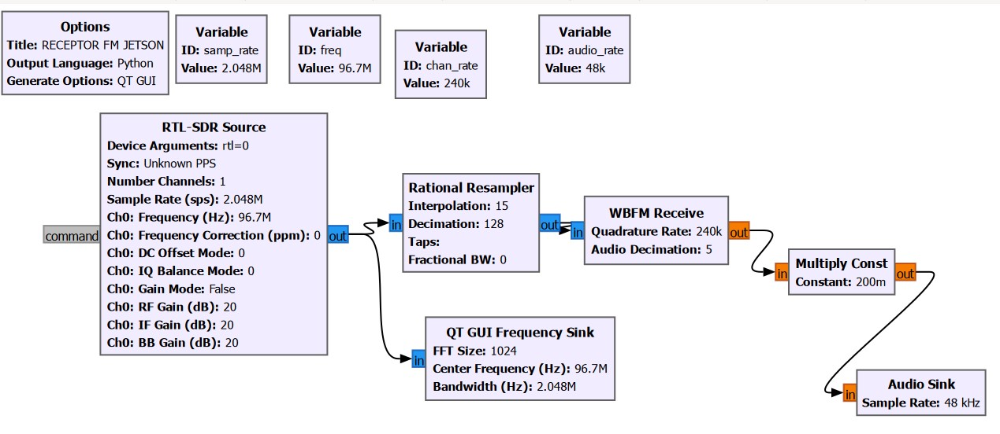
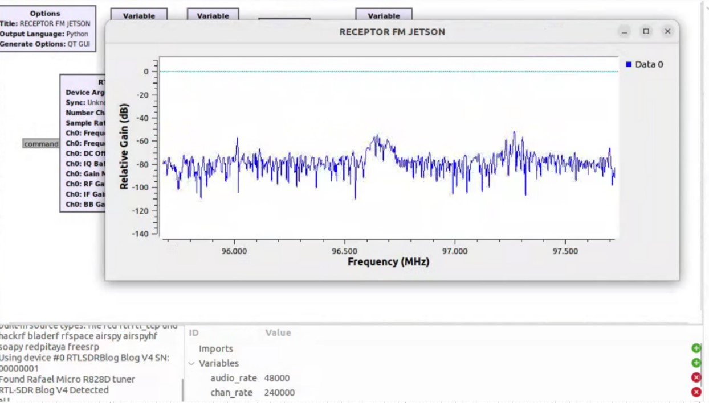

# Receptor FM con RTL-SDR

Flujo GNU Radio Companion para sintonizar una emisora FM de radiodifusión, demodularla y reproducir el audio. Requiere GNU Radio 3.10, soporte `gr-osmosdr`/RTL-SDR y una salida de audio funcional. El GRC es la referencia editable; `fm_rx_jetson.py` es el flujo Python generado.

## Ejecución

Con el RTL-SDR conectado y reconocido por `gr-osmosdr`, desde este directorio:

```bash
python3 fm_rx_jetson.py
```

En GNU Radio Companion, abrir `fm_rx_jetson.grc` y pulsar ejecutar. La sintonía inicial es 96,7 MHz; `freq` puede cambiarse en el GRC. La recepción depende de antena, cobertura, dispositivo y configuración local de audio.

## Parámetros y flujo

- RTL-SDR `rtl=0`, un canal, frecuencia central 96,7 MHz y tasa de entrada 2,048 MS/s. Ganancias configuradas en 20 dB (RF, IF y baseband); ganancia automática desactivada.
- El mismo flujo complejo alimenta el espectro Qt GUI (FFT de 1024 puntos, ventana Blackman-Harris) y un remuestreador racional `L/M = 15/128`: 2,048 MS/s × 15/128 = 240 kS/s.
- `analog.wfm_rcv` recibe esa tasa como `quad_rate=240000`, demodula FM de banda ancha y decima el audio por 5: 240 kS/s / 5 = 48 kS/s.
- Un multiplicador flotante `0.2` atenúa la amplitud antes del sumidero de audio configurado a 48 kS/s.

Las tasas y bloques anteriores se leen del GRC y coinciden con el Python generado. Las ganancias son valores de inicio; los niveles adecuados dependen del receptor y la señal. El espectro observa la señal compleja original a 2,048 MS/s, no la señal de audio.

## Diagramas

- [Diagrama del flujo FM](../../imagenes/fm_flujo.png)
- [Interfaz Qt GUI](../../imagenes/fm_qt_gui.png)
- [Explicación teórica de cada bloque](EXPLICACION_TEORICA/README.md)

## Referencias técnicas

- [Fuente GNU Radio 3.10.1.1: receptor WFM](https://github.com/gnuradio/gnuradio/tree/v3.10.1.1/gr-analog)
- [Fuente GNU Radio 3.10.1.1: remuestreador racional](https://github.com/gnuradio/gnuradio/tree/v3.10.1.1/gr-filter)
- [Fuente GNU Radio 3.10.1.1: bloques Qt GUI](https://github.com/gnuradio/gnuradio/tree/v3.10.1.1/gr-qtgui)
- [Fuente osmocom gr-osmosdr: RTL-SDR](https://github.com/osmocom/gr-osmosdr)

## Evidencia visual

### Flujo GNU Radio del receptor FM



La rama IQ alimenta el espectro y el remuestreador; la rama de audio termina a 48 kS/s.

### Interfaz Qt GUI durante recepción FM



La energía de la emisora aparece alrededor de la frecuencia sintonizada. La FFT representa IQ de entrada, no el audio demodulado.

