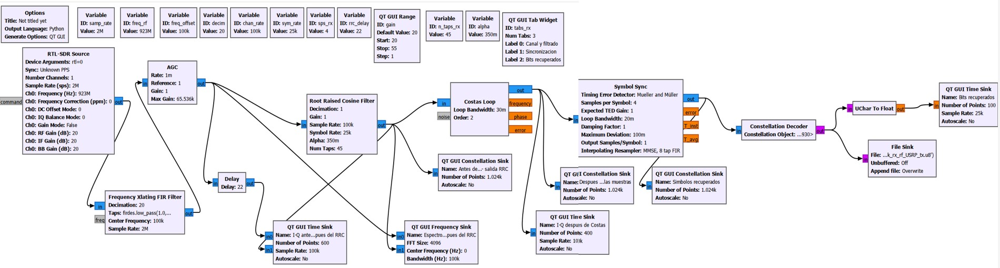
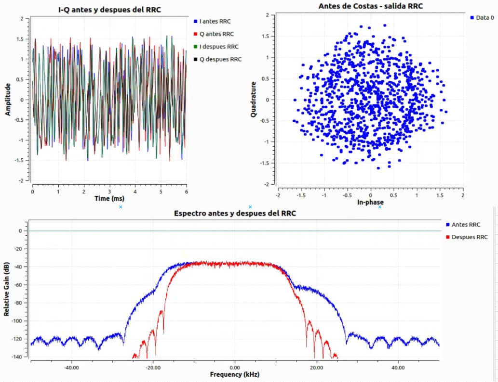
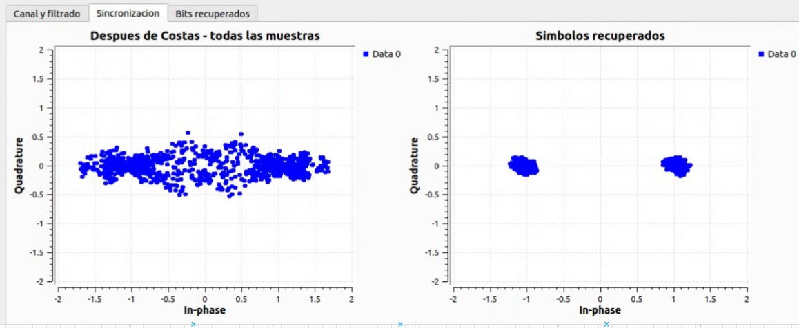
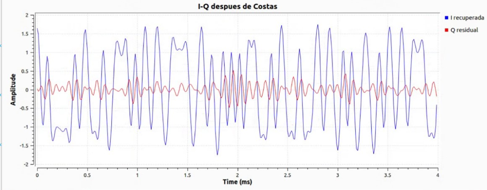
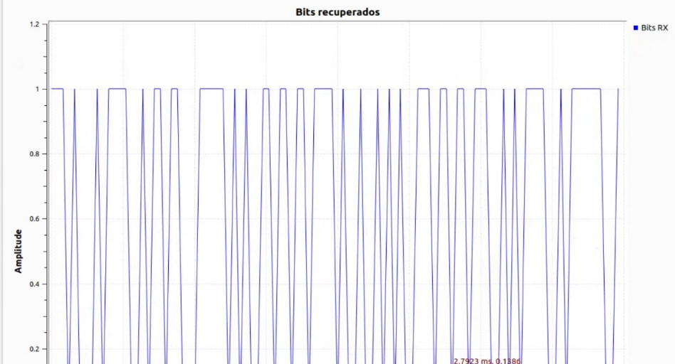
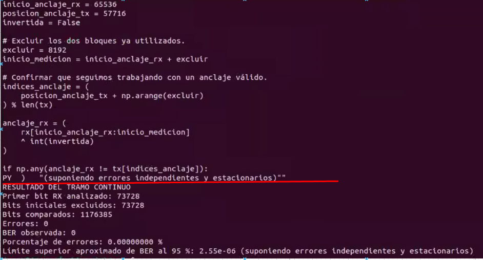

# Receptor BPSK: teoría y correspondencia con el flujo

Esta nota explica el receptor representado por `../bpsk_rx_usrp_a_jetsonRTL_base.grc` y el Python generado `../bpsk_rx_usrp_a_jetsonRTL.py`. Los valores siguientes se leen de esos archivos; las interpretaciones de las pantallas describen qué señales se conectan a cada visualizador. Una constelación compacta o una señal legible es un indicio de funcionamiento, no una medición de BER.

## 1. Señal y cadena de recepción

BPSK representa cada bit con una de dos fases separadas por π. En banda base ideal, escribimos `a[k] = A(2b[k]-1)`, con `b[k]∈{0,1}` y amplitud `A`; el alfabeto de símbolos es `{−A,+A}` sobre el eje I. Para una forma de pulso `p(t)` y período `T=1/R_s`, la señal transmitida equivalente en banda base compleja es `u(t)=Σ_k a[k]p(t−kT)`. Un modelo de las muestras recibidas, después de sintonizar una portadora próxima, es:

`r[n] = exp(j(2π Δf n/F_s + φ)) · Σ_k a[k](p_tx*h)(n/F_s − τ − kT) + w[n]`.

`F_s=2 MHz` antes de la decimación; `Δf` es el error de frecuencia residual en Hz, `φ` la fase inicial, `τ` el error de tiempo, `h(t)` el canal y `w[n]` el ruido complejo. El modelo separa los efectos que el receptor debe afrontar; el diagrama no estima cada parámetro por separado. El oscilador local puede tener diferencia de frecuencia y fase, y el instante de muestreo puede caer fuera del centro del símbolo. El flujo corrige esas degradaciones en secuencia:

```text
RTL-SDR IQ → traslación de frecuencia + FIR/decimación → AGC → RRC
           → Costas (fase/frecuencia) → Symbol Sync (temporización)
           → decoder BPSK → bytes y visualizador de bits
```

El punto del diagrama donde se conectan los monitores es importante: unas observan muestras antes del filtro RRC, otras después del lazo Costas y otras después del sincronizador de símbolo.

## 2. Variables y tasas calculadas

| Variable GRC | Valor/expresión | Valor inicial | Función |
|---|---:|---:|---|
| `samp_rate` | `2e6` | 2 000 000 muestras/s | Tasa compleja del RTL-SDR. |
| `freq_rf` | `923e6` | 923 MHz | Frecuencia central del sintonizador. |
| `freq_offset` | `100e3` | 100 kHz | Frecuencia de traslación del FIR complejo. |
| `decim` | `20` | 20 | Factor de decimación del canal. |
| `chan_rate` | `samp_rate/decim` | 100 000 muestras/s | Tasa después del filtro de canal. |
| `sym_rate` | `25e3` | 25 000 símbolos/s | Tasa nominal de símbolos BPSK. |
| `sps_rx` | `chan_rate/sym_rate` | 4 muestras/símbolo | Muestras por símbolo a la entrada del conformador/módem. |
| `alpha` | `0.35` | 0.35 | Factor de exceso de ancho de banda del RRC. |
| `n_taps_rx` | `11*int(sps_rx)+1` | 45 coeficientes | Longitud del filtro RRC. |
| `rrc_delay` | `(n_taps_rx-1)//2` | 22 muestras = 220 μs | Retardo de grupo nominal usado para alinear el monitor temporal. |
| `gain` | deslizador 20–55, paso 1 | 20 dB | Ganancia RF inicial que se configura en el sintonizador. |

La relación de muestreo es `2 000 000 / 20 = 100 000` muestras/s; después, `100 000 / 25 000 = 4` muestras por símbolo. El período de símbolo es `T_s = 1/R_s = 40 μs`. Para pulsos rectangulares NRZ, el espectro sinc tiene primeros nulos en `±R_s`, o ancho nulo-a-nulo `2R_s`; no hay ancho de banda estrictamente limitado. El mínimo ancho Nyquist de coseno alzado (`α=0`) es `R_s` total. Con roll-off `α=0.35`, el ancho de banda ideal RC/RRC total es `(1+α)R_s = 33.75 kHz` (±16.875 kHz). El filtro de canal de 20 kHz de corte y transición de 10 kHz es un filtrado previo con margen, con parámetros referidos a tasa de muestreo original; no debe confundirse con ese ancho ideal de pulso.

## 3. Bloques de procesamiento, uno por uno

### 3.1 `RTL-SDR Source` (`rtlsdr_source_0`)

Fuente compleja `fc32`, un canal, `rtl=0`. El Python generado configura tasa 2 MS/s, sintonía a 923 MHz, corrección de frecuencia cero, modo de ganancia manual, ganancia RF de 20 dB, IF y banda base a 20 dB, sin selección explícita de antena y ancho de banda automático (`0`). El deslizador `gain` permite variar la ganancia RF entre 20 y 55 dB. No configura AFC del sintonizador: la corrección residual de portadora se deja al lazo Costas.

Las muestras IQ tienen una parte real I y una imaginaria Q. Cambios en amplitud aparecen en la distancia al origen; un giro progresivo de fase entre símbolos suele indicar error residual de frecuencia.

### 3.2 `Frequency Xlating FIR Filter` (`freq_xlating_fir_filter_xxx_0`)

Bloque complejo FIR con decimación 20, tasa de entrada `samp_rate`, frecuencia central `freq_offset=100 kHz` y taps `firdes.low_pass(1.0, samp_rate, 20e3, 10e3)`. El bloque traslada el centro seleccionado a banda base, aplica el pasa-bajos y entrega 100 kS/s. La configuración de taps usa ganancia 1, frecuencia de corte 20 kHz y transición 10 kHz a la tasa de entrada de 2 MS/s. El filtro antialias se aplica antes de reducir la tasa.

En notación discreta, el mezclador complejo aplica `x_m[n]=x[n]exp(−j2π f_off n/F_s)` para llevar a cero un componente situado en `+f_off`; el FIR y la reducción de tasa se pueden representar como `y[m]=Σ_l h[l]x_m[20m−l]`. La traslación con `freq_offset` es relativa a la sintonía RF y su signo determina qué lado del centro se lleva a cero. Para recibir una señal desplazada al lado contrario puede requerirse ajustar el signo o el centro, según hardware y frecuencia observada. Taps efectivos: `firdes.low_pass(1.0, 2 MHz, 20 kHz, 10 kHz)`, filtro previo al diezmado que también suprime energía que podría plegarse. GNU Radio define el bloque como un FIR que traduce en frecuencia y diezma; su diseño de pasa-bajos recibe tasa, corte y transición como parámetros ([referencia del bloque](https://gnuradio.readthedocs.io/en/maint-3.10/classgr_1_1filter_1_1freq__xlating__fir__filter.html), [diseño digital de filtros](https://gnuradio.readthedocs.io/en/maint-3.10/group__filter__design.html)).

### 3.3 `AGC` complejo (`analog_agc_xx_0`)

La llamada generada equivale a `analog.agc_cc(rate=1e-3, reference=1.0, gain=1.0)`, con ganancia máxima 65536. En GNU Radio 3.10.1.1, primero `y[n]=g[n]x[n]`; luego `g[n+1]=g[n]+μ(R−|y[n]|)`, donde `μ=0.001` y `R=1`, y se limita `g` al máximo. El AGC complejo mide magnitud `sqrt(I²+Q²)`, no potencia `I²+Q²`. Si la salida queda debajo de la referencia, la realimentación tiende a subir la ganancia; si la supera, tiende a bajarla. ([Código oficial del núcleo AGC](https://github.com/gnuradio/gnuradio/blob/v3.10.1.1/gr-analog/include/gnuradio/analog/agc.h), [bloque AGC complejo](https://github.com/gnuradio/gnuradio/blob/v3.10.1.1/gr-analog/lib/agc_cc_impl.cc)). No corrige error de frecuencia, fase ni tiempo. Si el canal contiene ruido dominante o interferencia fuerte, normaliza esa energía también.

### 3.4 `Root Raised Cosine Filter` (`root_raised_cosine_filter_0`)

Filtro FIR complejo con `gain=1`, interpolación/decimación igual a 1 (no cambia la tasa), tasa de diseño `chan_rate=100 kS/s`, tasa de símbolos `sym_rate=25 ksym/s`, roll-off `alpha=0.35` y 45 taps. Con `T=1/R_s`, la magnitud ideal RC normalizada es:

`|H_RC(f)| = T` si `|f| ≤ (1−α)/(2T)`;
`|H_RC(f)| = (T/2)[1 + cos((πT/α)(|f|−(1−α)/(2T)))]` si `(1−α)/(2T) < |f| ≤ (1+α)/(2T)`;
`|H_RC(f)| = 0` en otro caso.

El RRC tiene magnitud `sqrt(|H_RC(f)|)`; al combinar un RRC TX y otro RX casados, el producto forma la respuesta RC que cumple el criterio Nyquist de cero ISI en los instantes ideales. Aquí los bordes de un lado son 8.125 kHz y 16.875 kHz, con ancho total nulo-a-nulo `(1+α)R_s = 33.75 kHz`. GNU Radio genera los taps usando ganancia, tasa de muestreo, tasa de símbolos, roll-off y número de coeficientes ([referencia `firdes`](https://gnuradio.readthedocs.io/en/maint-3.10/classgr_1_1filter_1_1firdes.html)).

Con 4 muestras/símbolo, 45 taps abarcan 44 intervalos de muestreo. Para un FIR simétrico de fase lineal, el retardo de grupo es `(N−1)/2=22` muestras, es decir `22/100000=220 μs=5.5T`. El bloque `Delay` de 22 muestras se conecta a una rama directa de AGC usada por la gráfica temporal para comparar señales alineadas; no se conecta a la ruta de decodificación.

### 3.5 `Costas Loop` complejo (`digital_costas_loop_cc_0`)

Recibe la salida del RRC. Está configurado como `costas_loop_cc(loop_bw=0.03, order=2, use_snr=False)`. `order=2` selecciona el detector para la simetría de BPSK (no es un orden de seguimiento variable); GNU Radio usa 4 para QPSK y 8 para 8-PSK ([API oficial Costas Loop](https://gnuradio.readthedocs.io/en/maint-3.10/classgr_1_1digital_1_1costas__loop__cc.html)).

En cada muestra el bloque desrota la entrada `z[n]=x[n]exp(−jθ[n])`, estima error de fase y actualiza el oscilador. El detector BPSK exacto de GNU Radio 3.10 es `e[n]=Re{z[n]}·Im{z[n]}`; cerca de ±I, el producto tiene signo proporcional al error angular pequeño. Con coeficientes de lazo $K_p$ y $K_i$ (distintos del roll-off del filtro), la actualización de segundo orden puede representarse como `ω[n+1]=ω[n]+K_i e[n]` y `θ[n+1]=θ[n]+ω[n+1]+K_p e[n]`, con fase envuelta y frecuencia limitada. GNU Radio recorta el error a magnitud 1, lo pasa al control loop y aplica la nueva fase al NCO ([código de Costas](https://github.com/gnuradio/gnuradio/blob/v3.10.1.1/gr-digital/lib/costas_loop_cc_impl.cc), [detector BPSK](https://github.com/gnuradio/gnuradio/blob/v3.10.1.1/gr-digital/lib/costas_loop_cc_impl.h)). `loop_bw=0.03` es normalizado, no se mide en Hz ni es ancho de canal. El parámetro controla rapidez frente a ruido de seguimiento. `use_snr=False` deja desactivada la variante que usa una estimación de ruido.

BPSK tiene ambigüedad de fase de π: el lazo puede converger a cualquiera de las dos orientaciones opuestas. Por tanto, aun cuando los puntos estén perfectamente sobre el eje I, puede hacer falta inversión lógica al comparar bits con la secuencia transmitida. La captura `.assert` usa `invertida=False` solo para su anclaje histórico validado.

### 3.6 `Symbol Sync` (`digital_symbol_sync_xx_0`)

La entrada proviene del Costas y todavía está a 4 muestras/símbolo. Parámetros efectivos de la llamada Python: detector Mueller and Müller (`TED_MUELLER_AND_MULLER`), `sps=4`, ancho de lazo `0.02`, ganancia del TED `1.0`, amortiguamiento `1.0`, desviación máxima `0.1`, una muestra por símbolo en la salida (`osps=1`), constelación BPSK, interpolador MMSE de 8 taps, 128 filtros y taps del filtro adaptado PFB vacíos (`[]`).

El TED M&M es de decisión dirigida. Si `z_k` son muestras interpoladas a tiempos de símbolo y `d_k=Q(z_k)` decisiones de una constelación normalizada a ±1, un error M&M común es `e_k=Re{conj(d_{k−1})z_k−conj(d_k)z_{k−1}}`. Al variar el instante de muestreo alrededor del centro, cambia el valor medio/signo de este error, que alimenta un lazo PI para corregir fase y período del reloj. GNU Radio requiere pulsos con picos para detectores decision-directed no emparejados internamente a un filtro; por eso el RRC precede al sincronizador. ([Cabecera de Symbol Sync](https://github.com/gnuradio/gnuradio/blob/main/gr-digital/include/gnuradio/digital/symbol_sync_cc.h), [código TED M&M](https://github.com/gnuradio/gnuradio/blob/main/gr-digital/lib/timing_error_detector.h)).

El código inicializa el período permitido entre `sps−max_dev` y `sps+max_dev`; en este receptor `4±0.1`, o sea entre 3.9 y 4.1 muestras/símbolo. `max_dev=0.1` se expresa en muestras/símbolo, no como porcentaje ni Hz. El `loop_bw=0.02` es normalizado. `osps=1` da una muestra de salida por símbolo, tasa media `100 kS/s/4=25 kitems/s`. Si hay gran offset de reloj o la calidad de las decisiones es deficiente, el lazo puede no enganchar.

### 3.7 `Constellation Decoder` (`digital_constellation_decoder_cb_0`)

Recibe símbolos sincronizados y los asigna al punto de `digital.constellation_bpsk().base()` más cercano: `i*=argmin_i |z−c_i|²`. Para los puntos ideales `c_i∈{−1,+1}`, esto equivale a decidir por el signo de I cuando Q es residual pequeño. La clase constelación de GNU Radio define la decisión por distancia a los puntos de referencia ([API constellation](https://gnuradio.readthedocs.io/en/maint-3.10/classgr_1_1digital_1_1constellation.html)). Produce bytes que representan índices de puntos, aquí usados como etiquetas 0/1. La etiqueta asociada a cada punto depende del orden del objeto constelación, por lo que mapeo y polaridad deben confirmarse contra TX.

### 3.8 `UChar to Float` y `File Sink`

`blocks.uchar_to_float_0` convierte las decisiones byte a float para graficarlas como niveles; no cambia la secuencia. El File Sink guarda directamente los bytes del decoder, con `append=False` (abre archivo nuevo/sobrescribe uno anterior) y `unbuffered=False`: utiliza buffering y puede no tener aún los últimos datos en disco hasta cerrar o vaciar el archivo. El cálculo de BER se realiza después de detener el flujo y cerrar el archivo. La ruta está bajo el home del usuario, en `sdr-alertas/datos/bpsk_rx_rf_USRP_tx.u8`; esa carpeta debe existir. La opción `unbuffered` gobierna el vaciado sin buffer ([File Sink GNU Radio](https://wiki.gnuradio.org/index.php?title=File_Sink)). El contenido son etiquetas binarias por byte (0 o 1), no bits empaquetados ni IQ.

## 4. GUI: tres pestañas y sus señales

Las imágenes de esta sección se encuentran en `../../../imagenes/` y muestran las etapas del receptor y el resultado de la medición realizada durante el desarrollo.

### Pestaña 1: «Canal y filtrado»

Incluye `qtgui_time_sink_x_0` (600 puntos, 100 kS/s, ventana temporal libre, eje vertical −2 a 2) con cuatro trazas: I y Q de la rama AGC retardada 22 muestras y I y Q de la salida RRC. Se usa para comparar la forma de onda antes y después del filtro con una compensación visual del retardo.

El `qtgui_freq_sink_x_0_0` grafica ambas señales complejas en dB relativos con FFT 4096, ventana Hann, promedio 0.1, ancho de banda 100 kHz y rango vertical −140 a +10 dB. «Antes RRC» es AGC, «Después RRC» es la salida del RRC. El filtro debe reducir componentes fuera de banda; el espectro depende de señal, nivel, sintonía y entorno.

El `qtgui_const_sink_x_0` muestra la salida RRC antes de Costas (1024 muestras, ejes I/Q ±2). Si hay offset de fase, ruido o transitorios, la nube puede no estar todavía concentrada sobre el eje real.





### Pestaña 2: «Sincronizacion»

`qtgui_const_sink_x_0_0` recibe salida de Costas antes de Symbol Sync: se dibujan todas las muestras a 4 muestras/símbolo. `qtgui_time_sink_x_1` observa esa misma señal con 400 puntos y etiquetas «I recuperada» y «Q residual». Para BPSK coherente se espera que Costas haga pequeña la componente Q y deje dos agrupaciones en el eje I; la ambigüedad de π puede permutar qué agrupación corresponde a 0 o 1.

`qtgui_const_sink_x_0_0_0` está después de Symbol Sync y muestra símbolos recuperados (1024 puntos, ejes ±2), normalmente una muestra por símbolo. Es la pantalla más directa para valorar si la temporización está concentrando las decisiones, pero no reemplaza una comparación de bits.





### Pestaña 3: «Bits recuperados»

`qtgui_time_sink_x_2` muestra los valores float convertidos desde el decoder: 100 muestras, tasa gráfica indicada de 25 kHz, eje vertical −0.2 a 1.2. Los niveles cercanos a 0 y 1 indican las etiquetas decididas; esta visualización no establece que coincidan con la trama TX ni mide BER.





La última imagen muestra la medición realizada durante el desarrollo: 1 176 385 bits comparados, cero errores y BER observada igual a cero. El cálculo y los índices de esa medición se explican en [VERIFICACION_BER.md](VERIFICACION_BER.md).

### Organización de Qt y escalas temporales

El bloque `QT GUI Tab Widget` con ID `tabs_rx` crea las tres pestañas; no recibe ni modifica muestras. La expresión `tabs_rx@0:0,0,1,1` de un monitor indica pestaña 0, fila 0, columna 0 y extensión de una fila por una columna. El propio widget se coloca en la ventana principal, no dentro de sí mismo. Dos monitores no deben ocupar las mismas celdas del mismo contenedor. Estos valores son posiciones de interfaz, sin relación con sincronización de símbolos.

Los parámetros de tasa de los monitores definen el eje de tiempo; el monitor no remuestrea la señal para corregir una tasa equivocada. Los 600 puntos a 100 kS/s abarcan nominalmente 6 ms, y los 400 puntos de Costas, 4 ms. Los 100 puntos de decisiones a 25 kitems/s abarcan nominalmente 4 ms. En frecuencia, una FFT de 4096 puntos a 100 kS/s tiene separación entre bins de aproximadamente 24,414 Hz; la ventana Hann determina la respuesta espectral efectiva, por lo que esa separación no equivale por sí sola a una resolución de instrumento calibrado. El promedio suaviza fluctuaciones pero no aumenta el nivel real recibido.

El `QT GUI Range` de ganancia actualiza una variable y el método del controlador correspondiente. No modifica la potencia del transmisor. Las variables GRC son expresiones Python que se evalúan al generar el programa; nombres como `chan_rate` y `sps_rx` hacen explícita la relación entre tasas. El import de `Path` se utiliza exclusivamente para que el destino del archivo dependa del directorio personal, y no de una cuenta específica.

## 5. Orden de comprobación al diagnosticar

1. Confirmar centro RF, frecuencia relativa del canal y presencia de energía en banda en el espectro.
2. Revisar nivel y ausencia de saturación; ajustar ganancia RF sin confundirla con la AGC digital.
3. Ver si la salida de RRC conserva una nube de señal coherente.
4. En salida Costas, verificar convergencia y reducción de Q; una constelación giratoria sugiere error de portadora o falta de enganche.
5. En salida Symbol Sync, revisar compactación de los dos grupos BPSK y estabilidad temporal.
6. Validar el archivo decodificado contra TX con alineamiento demostrado para esa captura. La metodología y las limitaciones se desarrollan en [VERIFICACION_BER.md](VERIFICACION_BER.md).
