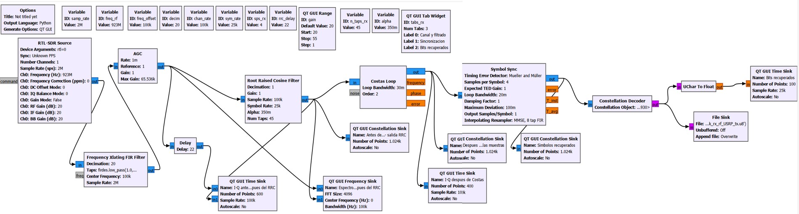
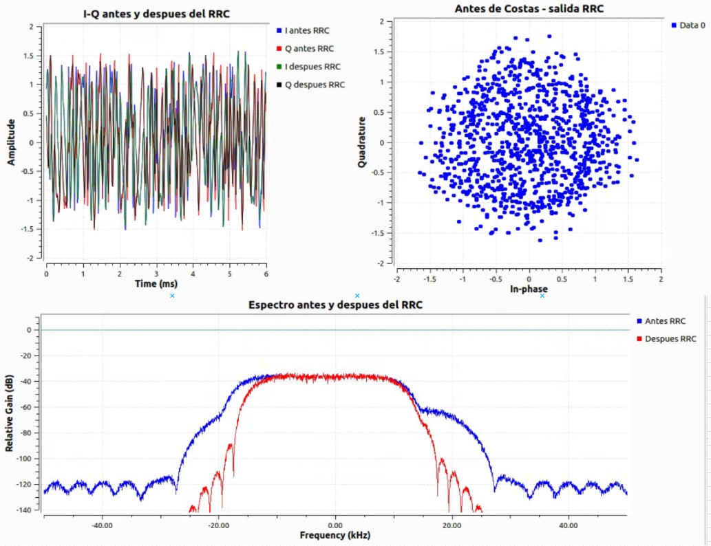
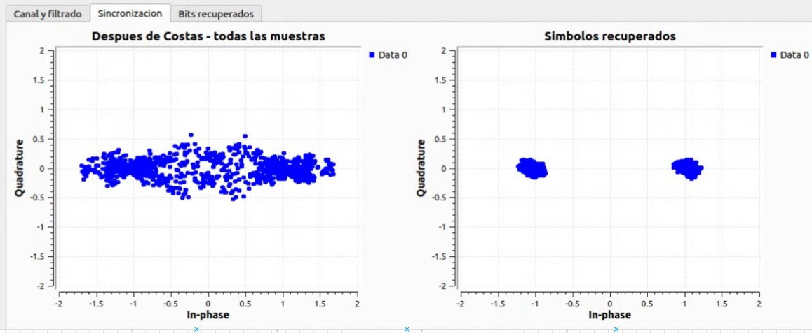
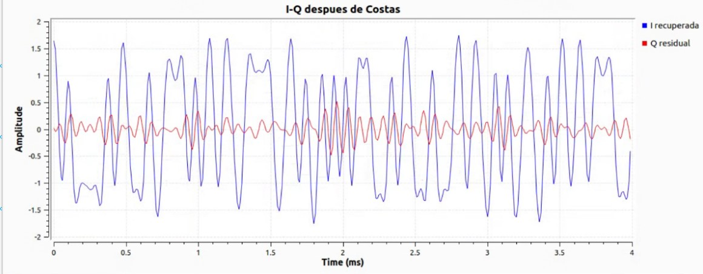
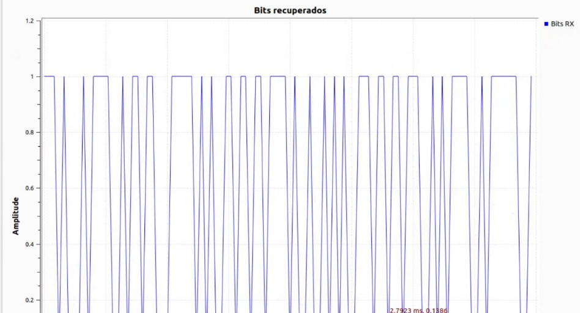
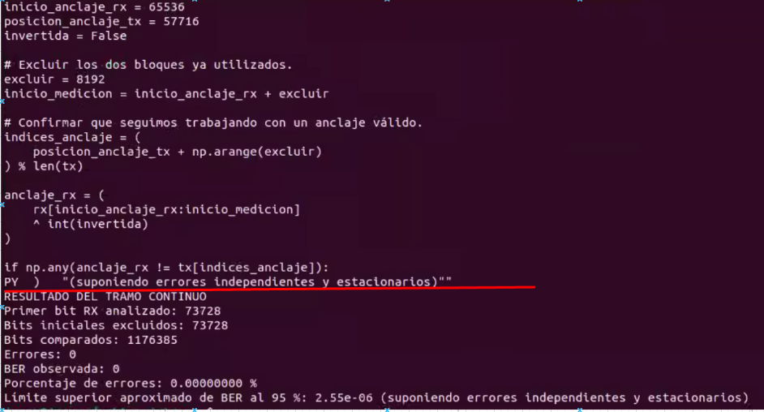

# Receptor BPSK con RTL-SDR

Este directorio contiene el diagrama GNU Radio Companion [`bpsk_rx_usrp_a_jetsonRTL_base.grc`](bpsk_rx_usrp_a_jetsonRTL_base.grc), su Python generado [`bpsk_rx_usrp_a_jetsonRTL.py`](bpsk_rx_usrp_a_jetsonRTL.py), la captura de bits TX/RX en `archivos_tx_y_rx/` y el apunte de comparación de BER [`comandos_comparacion_BER.assert`](comandos_comparacion_BER.assert).

El flujo recibe muestras complejas de un RTL-SDR, traslada y filtra el canal, normaliza amplitud, filtra con raíz de coseno alzado, recupera fase y temporización BPSK, decide bits y los guarda como bytes. La configuración inicial sintoniza su centro en 923 MHz y selecciona la señal a +100 kHz (923,1 MHz), muestreo RF de 2 MS/s, canal a 100 kS/s y 25 ksímbolos/s. La explicación bloque por bloque, las magnitudes y la lectura de la GUI están en [EXPLICACION_TEORICA/README.md](EXPLICACION_TEORICA/README.md).

La comparación BER tiene su propio contexto, supuestos y límites en [EXPLICACION_TEORICA/VERIFICACION_BER.md](EXPLICACION_TEORICA/VERIFICACION_BER.md). El archivo `.assert` conserva una comprobación de anclaje para una captura histórica concreta; no es una receta para aplicar índices fijos a cualquier captura.

## Ejecución

En un equipo que tenga GNU Radio 3.10, Qt y el módulo `gr-osmosdr`, desde la raíz del repositorio se preparan los datos y se abre el flujo con:

```bash
python3 datos_prueba/generar_bits.py
gnuradio-companion RTL_SDR_JETSON_files/implementacion_bpsk_rx/bpsk_rx_usrp_a_jetsonRTL_base.grc
```

El programa requiere un RTL-SDR accesible como `rtl=0` y una señal adecuada en la frecuencia configurada. El sumidero de archivo guarda en `~/sdr-alertas/datos/bpsk_rx_rf_USRP_tx.u8` (directorio `sdr-alertas/datos` bajo el home del usuario); el directorio debe existir antes de ejecutar el flujo. El diagrama configura salida byte sin signo y la decisión de constelación produce etiquetas 0/1. La recepción depende de la antena, el nivel de señal, la sintonía y la sincronización.

## Archivos de captura

- `archivos_tx_y_rx/bpsk_tx.u8`: secuencia de referencia de 100 000 bytes.
- `archivos_tx_y_rx/bpsk_rx_rf_USRP_tx.u8`: secuencia recibida guardada por el flujo; el archivo presente mide 1 252 730 bytes.

Estos son bytes de etiquetas de bit, no IQ crudo. La captura presente tiene longitud distinta de la captura histórica de 1 250 113 bytes citada en el `.assert`; la metodología BER detalla los índices correspondientes a cada registro. En la auditoría actual, el anclaje antiguo no coincide y la comparación continua desde el nuevo anclaje produce errores; no debe atribuirse a esta captura el cero errores histórico.

## Evidencia visual

### Diagrama del receptor BPSK



El procesamiento reduce la tasa, recupera fase y temporización y convierte los símbolos en decisiones binarias.

### Pestaña Canal y filtrado



Comparación temporal alineada, espectro antes/después del RRC y constelación previa a Costas. El filtrado suprime energía fuera de banda.

### Sincronización de portadora



Después de Costas, I conserva la modulación y Q debe reducirse. Se muestran varias muestras por símbolo y todavía pueden verse trayectorias entre puntos.

### Sincronización de símbolo



Después de Symbol Sync, una muestra por símbolo concentra las decisiones cerca de los dos puntos. La ambigüedad global de π aún exige resolver polaridad.

### Pestaña Bits recuperados



Los niveles 0/1 son decisiones del decoder convertidas a float para visualización. La corrección de esas decisiones se verifica contra la referencia.

### Resultado de la medición BPSK



La captura muestra la medición realizada durante el desarrollo: **1 176 385 bits comparados, cero errores y BER observada igual a cero**, desde la posición RX 73 728.


## Verificación de los bits

Desde la raíz del repositorio, para los archivos archivados:

```bash
python3 RTL_SDR_JETSON_files/implementacion_bpsk_rx/verificacion_ber_rf.py
```

Para una nueva captura, indicar `--tx` y `--rx` con las rutas correspondientes. El script histórico se conserva como [verificacion_ber_historica.py](verificacion_ber_historica.py); los controles de tamaño y anclaje deben impedir que se use con la captura actual.
