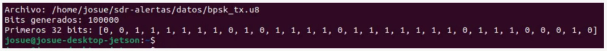

# 3. Generación de la secuencia de prueba

Una referencia conocida permite responder una pregunta medible: ¿las decisiones del receptor coinciden con los bits transmitidos? Se usa una secuencia pseudoaleatoria de 100 000 bits para evitar que una repetición trivial, como todos ceros, oculte problemas de mapeo o alineación.

El archivo contiene **100 000 bytes**, cada uno con valor numérico **0 o 1**. Representa 100 000 bits lógicos, no 800 000 bits de información independientes. La extensión `.u8` describe el tipo de almacenamiento (`uint8`); no modifica cómo se transmite la señal.

## Ejecución

Desde la raíz del repositorio, en la laptop y en la Jetson:

```bash
python3 datos_prueba/generar_bits.py
```

Se crea `~/sdr-alertas/datos/bpsk_tx.u8`, que es la ruta usada por los flujos. Para generar una referencia en otra ubicación:

```bash
python3 datos_prueba/generar_bits.py --salida ./referencia_temporal/bpsk_tx.u8
```

Las dos máquinas deben usar la misma referencia. La semilla 2026 y el procedimiento conservado reproducen los datos incluidos; comprobar SHA-256 evita suponer igualdad únicamente por el nombre del archivo.



## Archivos

- [generar_bits.py](generar_bits.py): versión ejecutable del código usado en las pruebas, con selección opcional de destino.
- [Explicación línea por línea](EXPLICACION_TEORICA/README.md): almacenamiento, semilla, generación y lectura por GNU Radio.

La referencia incluida tiene SHA-256:

```text
1d7cf9d325f349a6397b1b845c3572646ddfadd1d764a902dcbcbce4a2414d48
```
